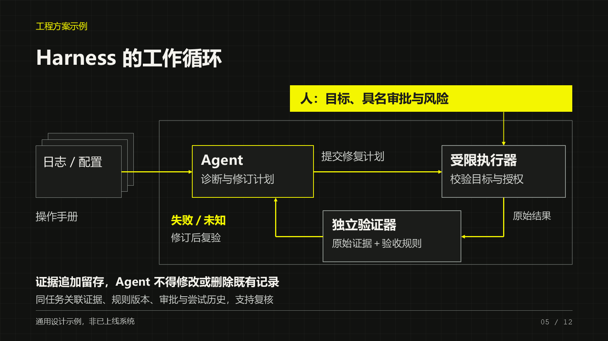
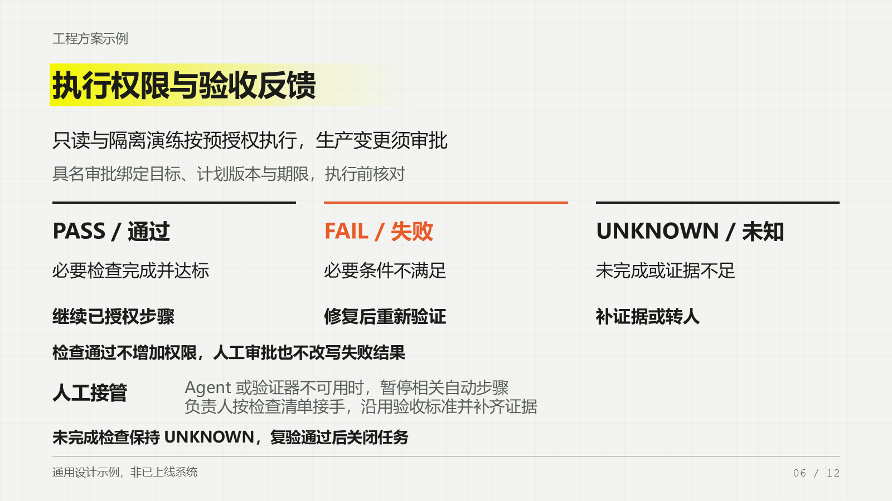
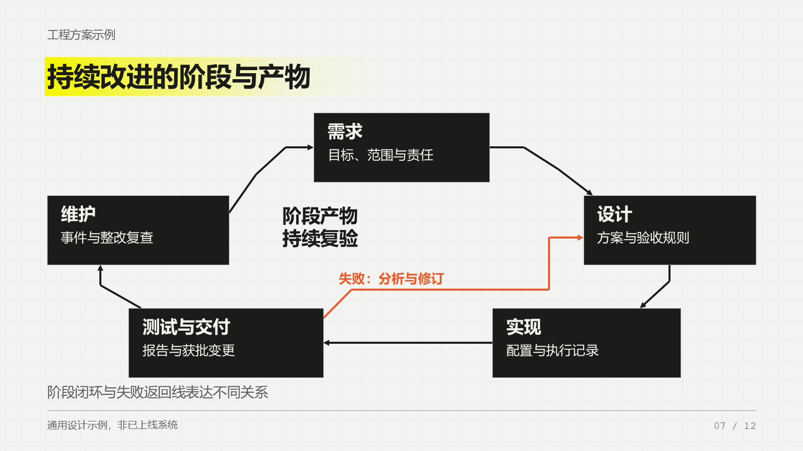
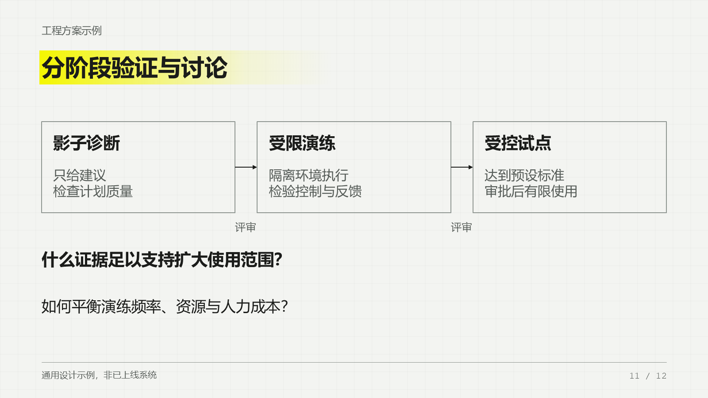

# Endfield PPT Skill · 终末地 PPT 技能

面向 DeepSeek 等具备工具调用能力的 Agent Harness，以黑色、冷白、荧光黄的终末地工业风格生成可编辑 PowerPoint。

模型读取 `SKILL.md` 并组织 JSON 内容，本地 PptxGenJS 生成器负责布局和导出。生成过程不调用模型 API，也不依赖 Codex 私有运行库。需要宿主提供文件读写、命令执行和结果检查能力。

**许可：CC BY-NC 4.0。** 本仓库公开源码供非商业分享与改编，保留上游作者署名；不宣称无限制商用。详见 [LICENSE](LICENSE) 和 [来源说明](references/NOTICE.md)。

## 布局预览

| 架构与证据 | 验收与人工接管 |
|---|---|
|  |  |

| 阶段闭环 | 讨论与展望 |
|---|---|
|  |  |

## 快速运行

安装 Node.js 20+（带 npm），克隆仓库后运行：

```sh
git clone https://github.com/UnivmemorN/endfield-ppt-skill.git
cd endfield-ppt-skill
npm ci --ignore-scripts
node scripts/generate.mjs --plan examples/overview.json --out output/demo.pptx
```

首次安装需要访问 npm；依赖就绪后，生成过程不需要联网、模型 API key 或 Codex。请使用本机已安装的中文字体。

随后让 Harness 读取 `SKILL.md`。接入方式、工具参数与模型提示示例见 [接入说明](references/harness-integration.md)，布局字段见 [plan 规范](references/plan-schema.md)。可运行 `npm test` 验证生成器。

也可以在 GitHub 点击 **Code → Download ZIP** 下载，解压后在项目目录执行以上安装与生成命令。

12 种布局包括封面、时间线、状态、职责、架构反馈、验收与人工接管、阶段环、表格、修复过程、对照、讨论和来源。示例不含真实用户身份或事故数据。

## 项目结构

```text
SKILL.md                   技能入口
scripts/                   JSON 校验、PPTX 生成与可选渲染工具
references/                设计规范、字段说明、Harness 接入及许可
examples/overview.json     六页匿名示例
examples/all-layouts.json  十二种布局目录
assets/                    上游背景、HTML 与匿名预览图
tests/                     生成、校验和文件保护测试
```

预设箭头有明确语义；选择布局前阅读 plan 规范。支持从 JSON 生成新版本，不直接导入或修改任意已有 PPTX。

## 能力与验证边界

- 保留黑／冷白／荧光黄、低对比网格、清晰主次，以及原生文本、表格与关系图。
- 支持从 JSON 生成新版本；不直接导入已有 PPTX，不等同通用 HTML 转 PPT。
- 生成器不负责图片生成、模型调用或渲染。预览需要 PowerPoint／LibreOffice 等外部工具。
- Windows 安装 PowerPoint 时，可用 `scripts/render-powerpoint.ps1` 导出 PNG 供检查；其他环境按宿主已有转换工具处理。
- 本包的验证记录见 [验证说明](references/validation.md)。未宣称已接入某个具体 DeepSeek Harness。

## 许可

视觉模板来自 **YUANZL** 的 [Endfield-PPT-Template](https://github.com/hs150521/Endfield-PPT-Template)。按 **CC BY-NC 4.0** 分享，保留署名和非商业条件；公开 npm 依赖另按其自身许可。详见 [来源与许可](references/NOTICE.md)。
